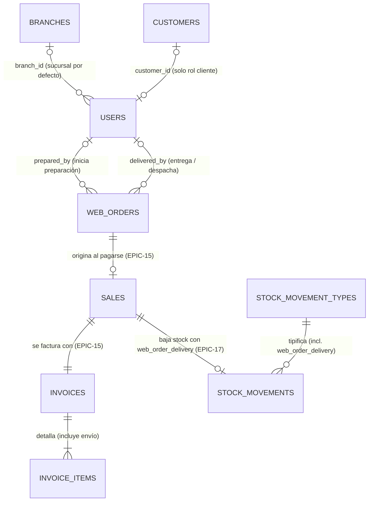

# Sprint Backlog 5 - Supermercados La Linda

**Sprint 5** · 11/10/2026 al 25/10/2026 · equipo de 6 personas (6 carriles individuales)
**Compromiso: 53 story points** en escala de Fibonacci (velocidad observada del equipo: 59 SP en Sprint 3 y 97 SP en Sprint 4).

> Este documento referencia los ítems por ID. Los criterios de aceptación viven en
> `product-backlog.md`; se escribieron en este planning a partir de la revisión del Sprint 4 con el
> Product Owner / Profesor del 12/10/2026.

---

## Objetivo del sprint

1. **Cerrar el circuito de entrega de pedidos web desde Depósito con baja de stock y tipo de movimiento propio:** cuando se acredita el pago de un pedido web con Mercado Pago se genera automáticamente la venta online confirmada y su factura A o B (`EPIC-15`), sin descontar todavía la mercadería. El encargado de depósito entra a su pantalla principal de pedidos a preparar, inicia la preparación (`en_preparacion`), junta los artículos y confirma la salida del depósito (`entregado`, mostrado como `"Despachado"` si es envío a domicilio) (`EPIC-17`): **en ese momento se registra el movimiento de sistema `"Salida por Entrega de Pedido Web"` y baja el stock del depósito**.
2. **Garantizar la disponibilidad online y completar filtros y ordenamiento en la tienda:** se impide que dos clientes compren el mismo stock calculando la disponibilidad online real descontando los pedidos ya pagados o en preparación pendientes de salir del depósito (`HU-048`), y el cliente filtra el catálogo por marca y rango de precios y lo ordena por precio y descripción (`HU-047`).
3. **Habilitar la administración de usuarios y roles fijos con Gates por módulo y pantalla principal por rol:** el Administrador gestiona al personal interno (`HU-003`) asignándole su rol operativo en `UserRole` (`administrador`, `gerente`, `compras`, `deposito`, `cajero`) protegido por Gates por módulo en código (`HU-004`), y cada rol aterriza al iniciar sesión en su pantalla principal de trabajo (`Gerente` en `/dashboard`, `Depósito` en los pedidos a preparar, `Cajero` en la caja).
4. **Construir el Tablero Gerencial (Dashboard) completo:** el Gerente consulta en `/dashboard` los ingresos facturados y cobrados por canal, sucursal y medio de pago (`EPIC-18`), los egresos devengados en comprobantes de proveedor frente a los pagos efectivos y egresos de caja (`EPIC-19`), el resultado neto y su evolución temporal (`EPIC-20`), y los indicadores operativos de artículos más vendidos, alertas de stock, compras por proveedor y pedidos pendientes de preparar (`EPIC-21`), filtrando todo el tablero por fecha, sucursal y canal y exportando la información (`EPIC-22`).

Al cierre del sprint debe existir este recorrido:

```text
Tienda online:   Catálogo público con disponibilidad real (HU-048)
                   → filtrar por categoría, marca y rango de precio y ordenar (HU-047)
                   → confirmar pedido y pagar con Mercado Pago (sandbox)
                   → pago acreditado (pagado) → venta online confirmada + factura A/B (EPIC-15)
                   → el stock físico aún no baja, pero queda comprometido para otro cliente (HU-048)

Depósito:        Iniciar sesión como Depósito → aterriza directo en Pedidos a preparar (HU-004)
                   → tomar el pedido pagado de Juan Pérez → pasar a en_preparacion (prepared_by)
                   → juntar artículos del depósito (picking) y confirmar entrega/despacho
                   → pasa a entregado (etiqueta "Despachado" si es envío, delivered_by)
                   → se genera "Salida por Entrega de Pedido Web" y baja el stock (EPIC-17)

Cajero:          Iniciar sesión como Cajero → aterriza directo en la Caja (HU-004)
                   → opera su turno y ventas; recibe 403 si intenta abrir /dashboard o /purchases

Gerencia:        Iniciar sesión como Gerente → aterriza directo en /dashboard (HU-004)
                   → ver ingresos por canal, sucursal y medio de pago (EPIC-18)
                   → ver egresos devengados de proveedores vs. órdenes de pago y egresos de caja (EPIC-19)
                   → ver resultado neto y gráfico evolutivo ingresos vs. egresos (EPIC-20)
                   → ver top vendidos, compras por proveedor y alertas operativas (EPIC-21)
                   → filtrar por fechas, sucursal y canal y exportar a CSV / Excel (EPIC-22)
```

---

## Qué pidió el Product Owner y cómo se cubre

| # | Pedido del PO (12/10) | Se cubre con | Decisión de alcance |
|---:|---|---|---|
| 1 | *"¿Hacemos un ajuste? No, cuando se entrega la mercadería... El stock baja cuando entregás, cuando vos lo sacás del depósito, no cuando lo vendés"* | `EPIC-15`, `EPIC-17` (pasan a historias) | `EPIC-15` crea la venta online y su factura al acreditarse el pago; `EPIC-17` descuenta el stock al salir del depósito con el tipo propio `"Salida por Entrega de Pedido Web"` |
| 2 | Que dos clientes no se vean afectados comprando mercadería sin stock mientras un pedido aguarda despacho | `HU-048` | Se incorpora `HU-048`: la disponibilidad online resta del saldo del depósito online las unidades comprometidas en pedidos `pagado` y `en_preparacion` |
| 3 | Que la preparación y entrega la realice el usuario de Depósito y que cada puesto entre a su módulo | `HU-003`, `HU-004`, `EPIC-17` | Se amplía el enum `UserRole` (`administrador`, `gerente`, `cajero`, `deposito`, `compras`, `cliente`), se aplican Gates por módulo y cada rol entra a su pantalla principal |
| 4 | Filtrar y ordenar el catálogo de la tienda online | `HU-047` (reestimada a 3 SP) | Filtros combinables por marca y rango de precios y ordenamiento por precio y descripción sobre el precio resuelto |
| 5 | Cerrar el Dashboard gerencial completo (ingresos, egresos, evolución, KPIs y filtros) | `EPIC-18` a `EPIC-22` (pasan a historias) | Tablero gerencial unificado en `/dashboard` con gráficos (`shadcn chart` / `recharts`), filtros globales y exportación |

---

## Decisiones del planning

1. **Roles fijos en `UserRole` + Gates en código en lugar de las tablas `roles`/`permissions`/`permission_role` (`HU-004`).**
   - Se amplía el enum `App\Enums\Security\UserRole` existente (`users.role` ya es `varchar(50)`): `administrador`, `gerente`, `cajero`, `deposito`, `compras`, `cliente`.
   - La migración del Día 1 convierte los registros actuales con `role = 'personal_interno'` a `'administrador'`.
   - Se definen Gates por módulo en código (`view-dashboard`, `manage-web-orders`, `manage-users`, `operate-cash`, `manage-catalog`, `manage-pricing`, `manage-purchases`, `manage-stock`, `manage-customers`, `manage-organization`) y se aplican con middleware `can:<gate>` por grupo de rutas en `routes/web.php`.
   - Se mantiene `Gate::before` para `UserRole::Administrador`.
   - `UserFactory` incorpora un state por rol (`User::factory()->gerente()`, `->cajero()`, `->deposito()`, `->compras()`, `->administrador()`, `->cliente()`).
   - Se eliminan `role_id` y las tablas `roles`, `permissions` y `permission_role` del DER (`branch_id` e `is_active` en `users` se mantienen).
   - La matriz editable de permisos por rol pasa a **"Fuera del sprint / deseable"** y se agrega como pregunta al PO.
2. **Pantalla principal por rol al iniciar sesión (`LoginResponse` y redirección raíz).**
   - `Gerente` (y `Administrador`) → `/dashboard`
   - `Depósito` → bandeja de pedidos web a preparar (`/ecommerce/orders`)
   - `Cajero` → la caja (`/sales/cash-sessions`)
   - `Compras` → órdenes de compra (`/purchases/orders`)
   - `Cliente` → tienda online (`route('tienda.home')`)
3. **Incorporación de `HU-048` para proteger a dos clientes concurrentes.** Como el stock físico del depósito online recién baja cuando el depósito entrega el pedido (`EPIC-17`), la disponibilidad online (`available_quantity`) se calcula como la existencia física del depósito `is_ecommerce = true` **menos** las cantidades comprometidas en pedidos con estado `pagado` o `en_preparacion`. Se valida al agregar al carrito y dentro de la transacción de `PlaceWebOrder` (`HU-062`).
4. **Tipo de movimiento de stock propio `"Salida por Entrega de Pedido Web"` (`EPIC-17`).** Se agrega a `StockMovementType` el código `CODE_WEB_ORDER_DELIVERY = 'web_order_delivery'` (`name = 'Salida por Entrega de Pedido Web'`, `sign = -1`, `is_system = true`), incluido en `AUTOMATIC_CODES` para que **no sea elegible en ajustes manuales** (`HU-017`). Responde al *"¿hacemos un ajuste? No"* del PO, deja distinguible en el historial (`HU-018`) la `"Salida por Venta"` de mostrador (`sale_exit`) de la entrega online (`web_order_delivery`) y reutiliza `stock_movements.sale_id`.
5. **Máquina de estados simplificada en `web_orders` (`EPIC-17`).**
   - Cuatro estados: `pendiente` → `pagado` → `en_preparacion` → `entregado`, mostrando en la interfaz la etiqueta **"Despachado"** cuando `delivery_method = 'envio'` y **"Entregado"** cuando `delivery_method = 'retiro'`. El pedido se cierra al salir del depósito.
   - **Quedan fuera:** `listo_para_retiro`, `en_camino`, `cancelado`, `ready_or_dispatched_at` y `cancelled_at`.
   - **Motivo:** con `en_camino` nadie registra en el sistema la recepción final en el domicilio del comprador, y `cancelado` no tiene flujo de devolución del pago en Mercado Pago.
6. **Auditoría separada de preparación y entrega en `web_orders` (`EPIC-17`).** En lugar de un único `dispatched_by_user_id`, se registran `preparation_started_at` + `prepared_by` (`FK → users` nullable) al pasar a `en_preparacion`, y `delivered_at` + `delivered_by` (`FK → users` nullable) al cerrar el pedido en `entregado`.
7. **Integridad en el esquema y states de factory desde el Día 1.**
   - En `sales`: `CHECK ((channel = 'online' AND web_order_id IS NOT NULL) OR (channel = 'mostrador' AND web_order_id IS NULL))`.
   - En `web_orders`: `CHECK ((status = 'entregado' AND delivered_at IS NOT NULL AND delivered_by IS NOT NULL) OR (status <> 'entregado' AND delivered_at IS NULL AND delivered_by IS NULL))` e índice compuesto `INDEX (status, paid_at)`.
   - En `WebOrderFactory`: states `paid()`, `inPreparation()` y `delivered()` incluidos en el PR de esquema del Día 1.
8. **Dependencia nueva de gráficos (`shadcn chart` / `recharts`) pendiente de aprobación.** Para las visualizaciones de `EPIC-18`, `EPIC-19` y `EPIC-20` se solicita incorporar el componente `chart` de shadcn (`recharts`), sujeto a aprobación del equipo/líder técnico antes de modificar `package.json`.
9. **Estimaciones estrictamente en escala de Fibonacci (`1, 2, 3, 5, 8, 13`).** Se eliminan los valores intermedios (`4` y `6` SP) y se reestiman los ítems del sprint en números de Fibonacci puros, sumando **53 SP**.

---

## Ítems comprometidos (53 SP — escala de Fibonacci)

| # | ID | Título | SP | Carril | Depende de |
|---:|---|---|---:|---|---|
| 1 | **EPIC-15** | Procesar el pedido pagado como una venta online con su factura (reestimada, antes 8) | 5 | Carril 1 | HU-050, HU-042 |
| 2 | **HU-048** | Mostrar la disponibilidad online e impedir la compra sin stock | 3 | Carril 1 | HU-046, HU-016 |
| 3 | **EPIC-17** | Despachar y entregar pedidos web desde depósito con baja de stock | 8 | Carril 2 | EPIC-15, EPIC-06 |
| 4 | **HU-003** | Administrar los usuarios del sistema | 5 | Carril 3 | — |
| 5 | **HU-047** | Buscar, filtrar y ordenar artículos en la tienda online (reestimada, antes 5) | 3 | Carril 3 | HU-046 |
| 6 | **HU-004** | Administrar roles y sus permisos (enum `UserRole` + Gates + inicio por rol) | 8 | Carril 4 | HU-003 |
| 7 | **EPIC-18** | Visualizar los ingresos del período (reestimada, antes 8) | 5 | Carril 5 | EPIC-15, HU-042 |
| 8 | **EPIC-20** | Visualizar la relación entre ingresos y egresos y su evolución (reestimada, antes 8) | 5 | Carril 5 | EPIC-18, EPIC-19 |
| 9 | **EPIC-19** | Visualizar los egresos del período | 5 | Carril 6 | HU-027, HU-058 |
| 10 | **EPIC-21** | Visualizar indicadores operativos complementarios (reestimada, antes 5) | 3 | Carril 6 | EPIC-20, EPIC-17 |
| 11 | **EPIC-22** | Filtrar y exportar el tablero gerencial (reestimada, antes 5) | 3 | Carril 6 | EPIC-20 |
| | | **Total comprometido** | **53** | | |

---

## Orden de ataque y paralelización (6 carriles individuales)

Cada developer es dueño de sus ítems de punta a punta (backend, frontend y tests).

```text
┌──────────────────────────────────────────────────────────────────────────────┐
│ CARRIL 1 (Dev 1 — 8 SP): Venta Online y Disponibilidad                       │
│ • D1: PR de Esquema (migraciones + CHECKs + tipo movimiento + factories)     │
│ • 1. EPIC-15 (5 SP) Pedido pagado → venta online confirmada + factura A/B    │
│ • 2. HU-048  (3 SP) Disponibilidad online descontando comprometido y bloqueo │
├──────────────────────────────────────────────────────────────────────────────┤
│ CARRIL 2 (Dev 2 — 8 SP): Preparación y Entrega en Depósito                   │
│ • 1. EPIC-17 (8 SP) Bandeja de depósito, en_preparacion → entregado          │
│                     ("Despachado" si envío) + "Salida por Entrega Pedido Web"│
├──────────────────────────────────────────────────────────────────────────────┤
│ CARRIL 3 (Dev 3 — 8 SP): Usuarios Internos y Catálogo Tienda                 │
│ • 1. HU-003  (5 SP) ABM de usuarios internos, baja lógica, cierre /register  │
│ • 2. HU-047  (3 SP) Filtros por marca/rango de precio y orden en /tienda     │
├──────────────────────────────────────────────────────────────────────────────┤
│ CARRIL 4 (Dev 4 — 8 SP): Roles, Gates, Inicio por Rol y Barrido de Tests     │
│ • D2: PR Contrato de Roles (UserRole, Gates, UserFactory states, Login)      │
│ • 1. HU-004  (8 SP) Middleware can: por módulo, sidebar por rol y barrido    │
│                     de tests de autorización (mergeado a más tardar el D6)   │
├──────────────────────────────────────────────────────────────────────────────┤
│ CARRIL 5 (Dev 5 — 10 SP): Tablero Gerencial — Base, Ingresos y Evolución     │
│ • D2: PR Base del Tablero (DashboardController, Request, DTO y layout shell) │
│ • 1. EPIC-18 (5 SP) Ingresos por canal, sucursal y medio de pago             │
│ • 2. EPIC-20 (5 SP) Resultado neto y gráfico evolutivo ingresos vs. egresos  │
├──────────────────────────────────────────────────────────────────────────────┤
│ CARRIL 6 (Dev 6 — 11 SP): Tablero Gerencial — Egresos, KPIs y Exportación    │
│ • 1. EPIC-19 (5 SP) Egresos devengados en comprobantes vs. pagos y caja      │
│ • 2. EPIC-21 (3 SP) Top vendidos, compras por proveedor y alertas operativas │
│ • 3. EPIC-22 (3 SP) Filtros globales por sucursal/canal y exportación Excel  │
└──────────────────────────────────────────────────────────────────────────────┘
```

### Contratos de arranque (D1 y D2)

1. **Esquema mergeado el D1 (Carril 1):**
   - Migraciones de `users`, `web_orders`, `sales`, `invoices`, `invoice_items` y el tipo de movimiento `"Salida por Entrega de Pedido Web"` (`web_order_delivery` en `StockMovementType` y `StockMovementTypeSeeder`).
   - Restricciones `CHECK` e índice `(status, paid_at)` en `web_orders`.
   - States de factory `paid()`, `inPreparation()`, `delivered()` en `WebOrderFactory`.
2. **Contrato de roles mergeado el D2 (Carril 4):**
   - Enum `UserRole` ampliado (`administrador`, `gerente`, `cajero`, `deposito`, `compras`, `cliente`) y migración de datos `personal_interno` → `administrador`.
   - `Gate::before` para `Administrador` y definición de los Gates por módulo (`view-dashboard`, `manage-web-orders`, `manage-users`, `operate-cash`, `manage-catalog`, `manage-pricing`, `manage-purchases`, `manage-stock`, `manage-customers`, `manage-organization`).
   - Un state por rol en `UserFactory` (`User::factory()->gerente()`, `->cajero()`, `->deposito()`, `->compras()`, `->administrador()`, `->cliente()`), dejando `administrador` como rol por defecto del factory para no romper los tests existentes antes del barrido del D6.
   - `LoginResponse` con redirección a la pantalla principal según el rol.
3. **Base del tablero mergeada el D2 (Carril 5):**
   - `DashboardController@index`, `DashboardFilterRequest` (fechas, `branch_id`, `channel`) y DTO `DashboardData` con propiedades anulables por bloque (`revenues`, `expenses`, `evolution`, `operational`).
   - Esqueleto de `resources/js/pages/dashboard.tsx` dividido en subcomponentes independientes (`DashboardRevenuesSection`, `DashboardExpensesSection`, `DashboardEvolutionSection`, `DashboardOperationalSection`) para que los Carriles 5 y 6 trabajen en paralelo sin pisarse.

### Cronograma día por día (D1 a D10)

| Día | Carril 1 (Venta Online + Stock Tienda) | Carril 2 (Entrega en Depósito) | Carril 3 (Usuarios + Filtros Tienda) | Carril 4 (Roles + Gates + Tests) | Carril 5 (Dashboard: Base + Ingresos + Evolución) | Carril 6 (Dashboard: Egresos + KPIs + Export) |
|---|---|---|---|---|---|---|
| **D1** | **PR Esquema D1** (migraciones, CHECKs, `web_order_delivery`, states `WebOrderFactory`) | Diseño de Actions `StartWebOrderPreparation` y `DeliverWebOrder` sobre states de factory | Backend de `HU-003`: `EnsureUserIsActive`, cierre de `/register`, Actions de usuarios | Preparar enum `UserRole`, Gates por módulo, states en `UserFactory` y `LoginResponse` | Armar `DashboardController`, `DashboardFilterRequest`, `DashboardData` y shell de `dashboard.tsx` | Diseño de queries de `GetDashboardExpenses` (`EPIC-19`) con tests unitarios |
| **D2** | `EPIC-15`: `ConvertPaidWebOrderToSale` + renglón de envío en `IssueInvoice` | `EPIC-17`: Actions de preparación y entrega con `"Salida por Entrega de Pedido Web"` | `HU-003`: Controlador, Form Requests y validaciones (último admin, caja abierta) | **PR Contrato Roles D2** mergeado (`UserRole`, Gates, `UserFactory`, inicio por rol) | **PR Base Tablero D2** mergeado + arranque de `GetDashboardRevenues` (`EPIC-18`) | Enchufar `GetDashboardExpenses` (`EPIC-19`) sobre la base del tablero mergeada |
| **D3** | `EPIC-15`: Integración con `MarkWebOrderAsPaid`, PDF en "Mis pedidos" y tests | `EPIC-17`: Controlador y bandeja de pedidos en depósito con índice `(status, paid_at)` | `HU-003`: Pantalla de usuarios, modal de clave temporal por única vez y filtros | `HU-004`: Compartir `auth.can` en Inertia y filtrar `app-sidebar.tsx` por rol | `EPIC-18`: Desglose por canal, sucursal y medio de pago + tarjetas KPI en frontend | `EPIC-19`: Tarjetas devengado vs. pagado, gráfico por medio de pago y tests |
| **D4** | **PR `EPIC-15` mergeado** · **Control D4** | `EPIC-17`: Vista de detalle (*picking*), etiqueta `"Despachado"`/`"Entregado"` en tienda | **PR `HU-003` mergeado** · **Control D4** | `HU-004`: Aplicar middleware `can:` por grupo de rutas en `routes/web.php` | **PR `EPIC-18` mergeado** · **Control D4** | **PR `EPIC-19` mergeado** · **Control D4** |
| **D5** | `HU-048`: Cálculo de `available_quantity` (saldo depósito − `pagado`/`en_preparacion`) | `EPIC-17`: Integración con la `Sale` real de `EPIC-15` y tests de punta a punta | `HU-047`: Backend de filtros (`brand_id`, `min_price`, `max_price`) y `sort` en `/tienda` | `HU-004`: Barrido de tests de todos los módulos usando los states de `UserFactory` | `EPIC-20`: Action `GetDashboardEvolution` (resultado neto, margen y serie sin huecos) | `EPIC-21`: Queries de top artículos vendidos y ranking de compras por proveedor |
| **D6** | `HU-048`: Validación en carrito y en `PlaceWebOrder` con bloqueo transaccional | **PR `EPIC-17` mergeado** · **Control D6** | `HU-047`: UI de filtros, chips removibles y selector de orden en `shop/index.tsx` | **PR `HU-004` + Barrido de tests mergeado (Tope D6)** · **Control D6** | `EPIC-20`: Gráfico comparativo ingresos vs. egresos y tarjeta de superávit/déficit | `EPIC-21`: Alertas de stock (`<= 0`) y conteo de pedidos `pagado`/`en_preparacion` |
| **D7** | `HU-048`: Badges en `/tienda`, bloqueo de botón sin stock y tests de concurrencia | Apoyo en pruebas cruzadas del circuito online → depósito → kardex (`HU-018`) | `HU-047`: Tests de filtrado por precio resuelto (`HU-056`) y ordenamiento | Verificación de redirección inicial por rol y permisos finos en botones de acción | **PR `EPIC-20` mergeado** | **PR `EPIC-21` mergeado** · Arranque de exportación en `EPIC-22` |
| **D8** | **PR `HU-048` mergeado** | Ajuste de seeders de demostración (pedidos web pagados y entregados) | **PR `HU-047` mergeado** | Ajuste de `DatabaseSeeder` con un usuario de prueba por cada rol operativo | Apoyo a Carril 6 en pulido visual del tablero y verificación de filtros por canal | `EPIC-22`: Exportación Excel/CSV del tablero respetando filtros y tests |
| **D9** | Pruebas integrales de los 4 ejes en `master` y `composer run ci:check` | Pruebas integrales de los 4 ejes en `master` | Pruebas integrales de los 4 ejes en `master` | Pruebas integrales de todos los roles de punta a punta | Pruebas integrales del tablero con datos reales de ambos canales | **PR `EPIC-22` mergeado** |
| **D10** | Ensayo del recorrido completo de la Review y cierre del sprint | Ensayo de la demo de Depósito | Ensayo de la demo de Tienda y Usuarios | Ensayo de la demo de Roles | Ensayo de la demo de Gerencia | Ensayo de la demo de Gerencia |

### Tabla de dependencias duras / blandas y caminos críticos con holgura

| Origen | Destino | Tipo | Motivo y cómo se destraba | Holgura |
|---|---|---|---|---|
| **PR Esquema (D1)** | Todos los carriles | **Dura** | Define columnas de `users`, `web_orders`, `sales`, `invoices` y states `paid()`/`inPreparation()`/`delivered()` | **0 días** (se mergea el D1) |
| **PR Contrato Roles (D2)** | `HU-003` (C3), `HU-004` (C4), `EPIC-17` (C2) | **Dura** | Provee el enum `UserRole`, los Gates y los states `User::factory()->deposito()`, `->gerente()`, etc. | **0 días** (se mergea el D2) |
| **PR Base Tablero (D2)** | `EPIC-18` (C5), `EPIC-19` (C6), `EPIC-20` (C5), `EPIC-21` (C6), `EPIC-22` (C6) | **Dura** | Provee `DashboardController`, `DashboardFilterRequest` y `DashboardData` | **0 días** (se mergea el D2) |
| **`EPIC-15` (C1)** | `EPIC-17` (C2) | **Blanda hasta D4 / Dura en D5** | Entre D1 y D4 el Carril 2 construye `EPIC-17` usando `WebOrder::factory()->paid()` con su `Sale` de factory; el D5 integra con `ConvertPaidWebOrderToSale` | **1 día** (D4 → D5) |
| **`EPIC-15` (C1)** | `EPIC-18` (C5) | **Blanda** | `GetDashboardRevenues` consulta `sales` confirmadas (`mostrador` y `online`); se prueba con `Sale::factory()` desde el D2 | **2 días** |
| **`EPIC-18` (C5) + `EPIC-19` (C6)** | `EPIC-20` (C5) | **Dura (en D5)** | `GetDashboardEvolution` reutiliza las sumatorias de ingresos y egresos del período | **1 día** (ambas cierran en D4; `EPIC-20` cierra en D7) |
| **`EPIC-17` (C2)** | `EPIC-21` (C6) | **Blanda** | El KPI de pedidos pendientes de entrega solo lee `web_orders` en `('pagado', 'en_preparacion')`, disponibles desde el D1 | **3 días** |
| **Caminos críticos** | — | — | **Camino crítico 1 (Permisos):** Esquema (D1) → Contrato Roles (D2) → `HU-004` + Barrido de tests (D6). **Camino crítico 2 (Tablero):** Base Tablero (D2) → `EPIC-18` + `EPIC-19` (D4) → `EPIC-20` (D7) → `EPIC-22` (D9). | **1 a 2 días de buffer (D9–D10)** |

### Archivos donde van a chocar y protocolo de coordinación

| Archivo caliente | Carriles que lo tocan | Regla para evitar conflictos de merge |
|---|---|---|
| `routes/web.php` | C2 (`EPIC-17`), C3 (`HU-003`), C4 (`HU-004`), C5/C6 (`Dashboard`) | En el D1/D2 se dejan declarados los grupos por módulo; C4 agrega los `->middleware('can:...')` recién en su PR del D5/D6 sobre los grupos ya existentes. |
| `resources/js/components/app-sidebar.tsx` | C2 (`EPIC-17`), C3 (`HU-003`), C4 (`HU-004`) | C2 y C3 agregan el ítem de menú en su sección; C4 aplica en un único PR el filtro de visibilidad por `auth.can`. |
| `app/Providers/FortifyServiceProvider.php` (y `AppServiceProvider.php`) | C3 (`HU-003`), C4 (`HU-004`) | Se concentra en el **PR Contrato de Roles del D2** (Gates, `Gate::before`, `LoginResponse`); C3 solo toca `config/fortify.php` y el middleware `EnsureUserIsActive`. |
| `database/factories/UserFactory.php` | C3 (`HU-003`), C4 (`HU-004`), y usado por todos | Se edita **una sola vez en el PR del D2** con todos los states (`administrador`, `gerente`, `cajero`, `deposito`, `compras`, `cliente`) e `is_active`. Nadie más lo modifica después. |
| `resources/js/pages/dashboard.tsx` | C5 (`EPIC-18`, `EPIC-20`), C6 (`EPIC-19`, `EPIC-21`, `EPIC-22`) | En el **PR Base del Tablero (D2)**, `dashboard.tsx` queda como un contenedor de 5 subcomponentes en archivos separados (`resources/js/pages/dashboard/partials/*.tsx`). Cada carril edita únicamente su propio archivo parcial. |
| `resources/js/types/generated.d.ts` | Todos los carriles (`spatie/laravel-data`) | No resolver conflictos a mano: al actualizar la rama con `master`, correr siempre `npm run types:generate` y commitear el archivo regenerado. |

### Mayor riesgo técnico: Barrido de tests de `HU-004` (tope D6)

Activar `can:<gate>` en todas las rutas del panel interno es **el mayor riesgo del sprint**, porque atraviesa los tests de todos los módulos construidos entre el Sprint 1 y el Sprint 4.
- **Mitigación en D2:** `UserFactory::definition()` pasa a crear por defecto usuarios con `role = UserRole::Administrador` (que pasa por `Gate::before`), de modo que los tests existentes de dominio sigan en verde cuando se monten los Gates.
- **Cierre obligatorio en D6:** el barrido de tests de autorización de `HU-004` (que prueba explícitamente qué puede y qué no puede hacer cada rol con `User::factory()->cajero()`, `->deposito()`, `->compras()`, `->gerente()`) debe mergearse **a más tardar el D6**, dejando D7–D9 libres de roturas transversales.

### Puntos de control D4 / D6 y orden de recorte

- **Punto de control D4 (jueves de la primera semana):** deben estar mergeados el Esquema (D1), el Contrato de Roles (D2), la Base del Tablero (D2), `EPIC-15` (Venta y Factura Online), `HU-003` (Usuarios), `EPIC-18` (Ingresos) y `EPIC-19` (Egresos).
- **Punto de control D6 (sábado / lunes):** deben estar mergeados `EPIC-17` (Entrega en Depósito con baja de stock) y `HU-004` con el barrido completo de tests.
- **Orden estricto de recorte si un carril se atrasa en D4 o D6:**
  1. **`EPIC-22`** (3 SP — exportación del tablero; los filtros básicos del D2 ya quedan funcionando)
  2. **`EPIC-21`** (3 SP — indicadores operativos complementarios del tablero)
  3. **`HU-047` / `HU-065`** (3 SP — filtros por marca/rango de precio y ordenamiento en la tienda; la búsqueda y categorías de `HU-046` ya existen)
  4. **`HU-048`** (3 SP — disponibilidad previa en la tienda)
- **No se recortan bajo ningún concepto:**
  - El **circuito de entrega online con baja de stock** (`EPIC-15` + `EPIC-17`).
  - Los **usuarios y roles** (`HU-003` + `HU-004`).
  - Los **ingresos, egresos y su evolución en el Tablero Gerencial** (`EPIC-18` + `EPIC-19` + `EPIC-20`).

---

## Desglose en tareas

Stack: Laravel + Inertia v3 + React. Tienda y despachos en `Ecommerce` / `Stock`; seguridad en
`Security` / `Settings`; tablero en `Dashboard`. Lógica en `app/Actions/{Module}`, respuestas en
`app/Data/{Module}`, validación en Form Requests.

### EPIC-15 — Procesar el pedido pagado como una venta online con su factura (5 SP)
- [ ] En el PR de esquema (D1): migración en `sales` (`web_order_id` único nullable, `shipping_amount`, `CHECK (channel = 'online' ⇔ web_order_id IS NOT NULL)`), ajuste de nulabilidad en `invoices` (`cash_session_id` y `user_id` nullable) e `invoice_items` (`article_id` nullable).
- [ ] Action `ConvertPaidWebOrderToSale`, invocada por `MarkWebOrderAsPaid` dentro de la misma transacción: devuelve la `Sale` existente si ya fue procesado (idempotencia), resuelve el depósito activo con `is_ecommerce = true` y su punto de venta activo, y crea la `Sale` `confirmada` (`channel = 'online'`, `cash_session_id = null`, `user_id = null`, `shipping_amount = $webOrder->shipping_cost`) con sus `sale_items` y desglose de neto e IVA (`HU-063`), sin descontar stock.
- [ ] Emitir la `Invoice` (`A` o `B` según la condición fiscal del cliente) reutilizando `IssueInvoice`; cuando `shipping_cost > 0`, agregar la línea `"Envío a domicilio"` (`article_id = null`, IVA 21%) para que el total facturado coincida exactamente con el importe pagado en Mercado Pago.
- [ ] Exponer la factura emitida y el botón de descarga de su PDF (`HU-043`) en el detalle del pedido en "Mis pedidos" del cliente y en la vista interna.
- [ ] Tests: pedido pagado con retiro y con envío genera venta + factura con totales exactos, idempotencia ante doble webhook y existencia de stock intacta tras el pago.

### HU-048 — Mostrar la disponibilidad online e impedir la compra sin stock (3 SP)
- [ ] Query/servicio de disponibilidad online que calcula `available_quantity` por artículo como el saldo en `stock_balances` del depósito `is_ecommerce = true` menos la suma de cantidades en `web_order_items` de pedidos en estado `'pagado'` o `'en_preparacion'`.
- [ ] Exponer el estado de disponibilidad (`disponible`, `ultimas_unidades`, `sin_stock`) y `available_quantity` en el catálogo público (`/tienda`) y en el carrito (`ResolveCartLine`).
- [ ] Validar en `AddCartItem` / `UpdateCartItem` y dentro de la transacción de `PlaceWebOrder` (`HU-062`, con bloqueo para evitar condiciones de carrera entre dos clientes) que la cantidad solicitada no supere `available_quantity`.
- [ ] En `resources/js/pages/shop/index.tsx` y `cart.tsx`, mostrar el badge de disponibilidad y deshabilitar `"Agregar al carrito"` / `"Confirmar pedido"` cuando no alcance el stock.
- [ ] Tests: dos clientes intentando comprar las últimas unidades; el pago/pedido del primero reduce la disponibilidad online del segundo aunque el depósito todavía no haya entregado la mercadería.

### EPIC-17 — Despachar y entregar pedidos web desde depósito con baja de stock (8 SP)
- [ ] En el PR de esquema (D1): agregar en `StockMovementType` y `StockMovementTypeSeeder` el tipo de sistema `"Salida por Entrega de Pedido Web"` (`CODE_WEB_ORDER_DELIVERY = 'web_order_delivery'`, `sign = -1`, `is_system = true`, incluido en `AUTOMATIC_CODES` para no ofrecerlo en ajustes manuales), migración en `web_orders` (`status` con `CHECK IN ('pendiente', 'pagado', 'en_preparacion', 'entregado')`, `preparation_started_at`, `prepared_by`, `delivered_at`, `delivered_by`, `CHECK (delivered_* ⇔ status = 'entregado')`, índice `(status, paid_at)`) y states `paid()`, `inPreparation()` y `delivered()` en `WebOrderFactory`.
- [ ] Action `StartWebOrderPreparation`: transiciona `pagado` → `en_preparacion` registrando `preparation_started_at = now()` y `prepared_by = auth()->id()`.
- [ ] Action `DeliverWebOrder`: transiciona `en_preparacion` → `entregado` registrando `delivered_at = now()` y `delivered_by = auth()->id()`, y ejecuta en la misma transacción el movimiento `"Salida por Entrega de Pedido Web"` (`web_order_delivery`) sobre el depósito online reutilizando `stock_movements.sale_id = $sale->id` (una única vez por venta, marcando conflicto de `EPIC-06` si alguna línea queda negativa).
- [ ] Pantalla operativa de pedidos web a preparar (pantalla principal del rol `deposito`) con contadores por estado, filtros por estado, modalidad de entrega, sucursal y fechas, hoja de preparación (*picking list*) y botones de iniciar preparación y confirmar entrega/despacho.
- [ ] En la vista de depósito y en "Mis pedidos" del cliente, mostrar la etiqueta **"Despachado"** cuando `status = 'entregado'` y `delivery_method = 'envio'` (y **"Entregado"** cuando es `retiro`).
- [ ] Tests: flujo `pagado` → `en_preparacion` → `entregado`, auditoría de `prepared_by` y `delivered_by`, movimiento `"Salida por Entrega de Pedido Web"` no elegible en ajustes manuales, descuento único en el depósito online y rechazo de transiciones inválidas.

### HU-003 — Administrar los usuarios del sistema (5 SP)
- [ ] En el PR de esquema (D1): columnas `branch_id` (`FK → branches`, nullable) e `is_active` (`boolean` default `true`) en `users`, y migración de datos `personal_interno` → `administrador`.
- [ ] Deshabilitar `Features::registration()` en `config/fortify.php` para cerrar `/register` en el panel interno (manteniendo el registro de clientes de `EPIC-11` en `/tienda/registro`).
- [ ] Middleware `EnsureUserIsActive`: impide iniciar sesión a usuarios inactivos y cierra la sesión en curso si un usuario pasa a `is_active = false`.
- [ ] Actions y controlador de usuarios (`/settings/users` o `/users`, protegido por `can:manage-users`): alta, edición de rol (`UserRole`) y sucursal, activación/desactivación lógica y blanqueo de contraseña (mostrando la clave generada o definida por única vez en pantalla).
- [ ] Validaciones: no desactivar al propio usuario en sesión, no dejar al sistema sin al menos un `administrador` activo y no desactivar a un usuario con turno de caja abierto.
- [ ] Tests: alta con clave inicial, login bloqueado para inactivo, cierre de sesión al desactivar, protección del último Administrador y de usuario con caja abierta.

### HU-047 — Buscar, filtrar y ordenar artículos en la tienda online (3 SP)
- [ ] Ampliar la query del catálogo público (`ShopCatalogController@index`) para recibir y validar `brand_id`, `min_price`, `max_price` (`max_price >= min_price`) y `sort` (`relevance`, `price_asc`, `price_desc`, `name_asc`, `name_desc`), combinables con `search` y `category_id` de `HU-046`.
- [ ] Aplicar el filtro de rango de precios y el ordenamiento `price_asc` / `price_desc` sobre el precio efectivo resuelto para el visitante actual (`HU-056`: lista particular del cliente si está logueado, o lista del canal `online` / `general`).
- [ ] Enviar al frontend las marcas activas con artículos publicables en el canal online.
- [ ] En `resources/js/pages/shop/index.tsx`, agregar selectores de marca, rango de precio mínimo y máximo, selector de ordenamiento, chips de filtros activos removibles, contador de resultados y botón "Limpiar filtros", preservando los parámetros al paginar.
- [ ] Tests: filtro por marca, rango de precios (visitante anónimo y cliente con lista particular), ordenamiento por precio y por descripción, combinación de filtros.

### HU-004 — Administrar roles y sus permisos (8 SP)
- [ ] En el PR Contrato de Roles (D2): ampliar `App\Enums\Security\UserRole` (`administrador`, `gerente`, `cajero`, `deposito`, `compras`, `cliente`), definir `Gate::before` para `Administrador` y los Gates por módulo (`view-dashboard`, `manage-web-orders`, `manage-users`, `operate-cash`, `manage-catalog`, `manage-pricing`, `manage-purchases`, `manage-stock`, `manage-customers`, `manage-organization`), agregar states por rol en `UserFactory` y actualizar `LoginResponse` para que cada rol entre a su pantalla principal (`Gerente` → `/dashboard`, `Depósito` → pedidos a preparar, `Cajero` → la caja, `Compras` → compras, `Cliente` → `/tienda`).
- [ ] Compartir `auth.user.role` y `auth.can` en `HandleInertiaRequests` y filtrar los módulos de `resources/js/components/app-sidebar.tsx` según los Gates activos.
- [ ] Aplicar `middleware('can:<gate>')` por grupo de rutas en `routes/web.php` y sembrar un usuario de demostración por cada rol en `DatabaseSeeder`.
- [ ] **Barrido de tests (mergeado a más tardar el D6):** actualizar los tests de módulos que requieran un rol específico y agregar la suite de autorización que verifica `200` en módulos permitidos, `403` en módulos no permitidos y redirección inicial para cada uno de los 5 roles.

### EPIC-18 — Visualizar los ingresos del período (5 SP)
- [ ] En el PR Base del Tablero (D2): `DashboardController@index`, `DashboardFilterRequest`, `DashboardData` y layout modular en `resources/js/pages/dashboard.tsx`.
- [ ] Action/query `GetDashboardRevenues`: sobre las ventas `confirmada` del período (`mostrador` y `online` de `EPIC-15`) calcula Total Facturado con IVA, Ingreso Neto sin IVA, IVA total, Cantidad de ventas confirmadas, Ticket promedio y variación porcentual respecto al período anterior.
- [ ] Desglose de ingresos por canal (`mostrador` vs. `online`), por sucursal y por medio de pago (movimientos `venta` de caja más cobros acreditados de Mercado Pago).
- [ ] Tarjetas de KPIs y gráficos de participación en `DashboardRevenuesSection.tsx` (usando `shadcn chart` / `recharts`, pendiente de aprobación).
- [ ] Tests: suma exacta de ventas confirmadas de mostrador y online, exclusión de ventas abiertas o descartadas y de pedidos `pendiente`, filtrado por canal y sucursal.

### EPIC-20 — Visualizar la relación entre ingresos y egresos y su evolución (5 SP)
- [ ] Action/query `GetDashboardEvolution`: calcula el Resultado Neto del período (`ingresos − egresos`), el margen porcentual y la serie temporal comparativa `Ingresos vs. Egresos` (día a día en rangos cortos o mes a mes en rangos de varios meses, completando con `0.00` los períodos sin movimientos).
- [ ] Indicador de Resultado Neto (superávit en verde / déficit en rojo) y gráfico evolutivo de barras/líneas en `DashboardEvolutionSection.tsx`.
- [ ] Tests: resultado neto positivo y negativo, serie temporal completa sin huecos.

### EPIC-19 — Visualizar los egresos del período (5 SP)
- [ ] Action/query `GetDashboardExpenses`: calcula el gasto devengado en proveedores (facturas + notas de débito − notas de crédito confirmadas, excluyendo remitos y anulados) y el desembolso real de dinero (órdenes de pago confirmadas + egresos operativos de caja `cash_movements` de tipo `egreso`, desglosado por medio de pago).
- [ ] Tarjetas comparativas (devengado vs. pagado), gráfico por medio de pago y enlaces a Pagos y Egresos (`HU-055`) y Cuentas Corrientes (`HU-028`) en `DashboardExpensesSection.tsx`.
- [ ] Tests: cálculo de comprobantes recibidos vs. órdenes de pago y egresos de caja, exclusión de remitos y anulados.

### EPIC-21 — Visualizar indicadores operativos complementarios (3 SP)
- [ ] Action/query `GetDashboardOperationalIndicators`: top artículos más vendidos del período (por unidades e importe facturado), ranking de compras por proveedor y saldo pendiente en cuenta corriente, artículos sin stock o en conflicto (`quantity <= 0` en `stock_balances`) y cantidad de pedidos web en estado `pagado` o `en_preparacion` pendientes de entrega en depósito (`EPIC-17`).
- [ ] Paneles de rankings y tarjetas de alerta con enlaces directos a Existencias, Pedidos Web por preparar y Cuentas Corrientes en `DashboardOperationalSection.tsx`.
- [ ] Tests: ranking de artículos más vendidos, ranking de proveedores y conteo de alertas de stock y de pedidos web pendientes.

### EPIC-22 — Filtrar y exportar el tablero gerencial (3 SP)
- [ ] Barra superior de filtros sincronizada con la URL (`date_from`, `date_to`, atajos *Hoy*, *Este mes*, *Mes anterior*, *Últimos 6 meses*, *Este año*, `branch_id` y `channel`) y endpoint `DashboardController@export` (`/dashboard/export`).
- [ ] Descarga del resumen del tablero en CSV / Excel respetando los filtros activos (siguiendo el patrón de `HU-028` y `HU-055`).
- [ ] Tests: filtros por defecto, validación de fechas, filtrado por sucursal y canal y respuesta de exportación.

---

## Diseño de datos (DER proyectado Sprint 5)

> **Esquema entregado por adelantado en el D1.** Todas las migraciones de este DER (tablas
> modificadas, restricciones `CHECK`, índice `(status, paid_at)`, el tipo de movimiento
> `"Salida por Entrega de Pedido Web"` y los states de `WebOrderFactory`) se mergean el día 1 en un
> único PR de esquema. No se crean las tablas `roles`, `permissions` ni `permission_role`: los roles
> viven en `users.role` (`UserRole`) y los permisos en Gates por módulo.



### Tablas nuevas

Ninguna tabla nueva en el Sprint 5 (se reutiliza `users.role` con el enum `UserRole` y `stock_movements.sale_id` con el nuevo tipo de sistema `web_order_delivery`).

### Tablas modificadas

#### `users` — HU-003, HU-004
| Columna | Tipo | Reglas |
|---|---|---|
| role | varchar(50) | ya existe; el enum `UserRole` pasa a `'administrador'`, `'gerente'`, `'cajero'`, `'deposito'`, `'compras'`, `'cliente'`. Migración de datos: `personal_interno` → `administrador` |
| branch_id | FK → branches | nullable (`nullOnDelete`); sucursal predeterminada opcional del empleado |
| is_active | boolean | default `true`; baja lógica e invalidación de sesión |

#### `web_orders` — EPIC-17
| Columna | Tipo | Reglas |
|---|---|---|
| status | varchar(30) | `CHECK (status IN ('pendiente', 'pagado', 'en_preparacion', 'entregado'))` |
| paid_at | timestamp | nullable; `CHECK ((status = 'pendiente' AND paid_at IS NULL) OR (status <> 'pendiente' AND paid_at IS NOT NULL))` |
| preparation_started_at | timestamp | nullable; fecha/hora en que depósito inició el armado |
| prepared_by | FK → users | nullable; usuario de depósito que inició la preparación |
| delivered_at | timestamp | nullable; fecha/hora en que salió del depósito |
| delivered_by | FK → users | nullable; usuario de depósito que confirmó la entrega/despacho |

*Restricciones e índices en `web_orders`:*
- `CHECK ((status = 'entregado' AND delivered_at IS NOT NULL AND delivered_by IS NOT NULL) OR (status <> 'entregado' AND delivered_at IS NULL AND delivered_by IS NULL))`
- `CHECK ((status IN ('en_preparacion', 'entregado') AND preparation_started_at IS NOT NULL AND prepared_by IS NOT NULL) OR (status IN ('pendiente', 'pagado') AND preparation_started_at IS NULL AND prepared_by IS NULL))`
- `INDEX web_orders_status_paid_at_index (status, paid_at)`

#### `sales` — EPIC-15
| Columna | Tipo | Reglas |
|---|---|---|
| web_order_id | FK → web_orders | nullable, `UNIQUE`; pedido web que originó la venta online |
| shipping_amount | decimal(12,2) | default `0`, `CHECK (shipping_amount >= 0)` |

*Restricción en `sales`:*
- `CHECK ((channel = 'online' AND web_order_id IS NOT NULL) OR (channel = 'mostrador' AND web_order_id IS NULL))`

#### `invoices` / `invoice_items` — EPIC-15
- **`invoices`:** `cash_session_id` y `user_id` pasan a `nullable` (obligatorios en mostrador; nulos cuando la factura la emite automáticamente el pago de Mercado Pago en una venta online).
- **`invoice_items`:** `article_id` pasa a `nullable` para admitir el renglón de concepto `"Envío a domicilio"` cuando `shipping_cost > 0`.

#### `stock_movement_types` — EPIC-17
- Se siembra/inserta en la migración del D1 el tipo de sistema `code = 'web_order_delivery'`, `name = 'Salida por Entrega de Pedido Web'`, `sign = -1`, `is_system = true`, `is_active = true`, incluido en `StockMovementType::AUTOMATIC_CODES`.

---

## Preguntas al PO

| # | Pregunta | Supuesto con el que se avanza | Afecta a |
|---:|---|---|---|
| 1 | ¿Alcanza con los 5 roles operativos fijos para el personal interno (`Administrador`, `Gerente`, `Encargado de compras`, `Encargado de depósito`, `Cajero`) o se necesita además una pantalla para crear roles nuevos y editar una matriz de permisos? | Alcanza con los 5 roles fijos en `UserRole` y permisos por módulo en código; la matriz editable queda fuera como deseable | `HU-004` |
| 2 | En un pedido web con envío a domicilio, ¿el pedido se da por cerrado (`entregado` / etiqueta `"Despachado"`) apenas sale del depósito, o hace falta que alguien registre después que llegó al domicilio? | Se cierra al salir del depósito con la etiqueta `"Despachado"` (nadie registra la recepción en la puerta del cliente) | `EPIC-17` |
| 3 | En el bloque de egresos del Tablero Gerencial, ¿el Resultado Neto (`EPIC-20`) se compara contra los comprobantes devengados de proveedores o contra los pagos efectivos (órdenes de pago + egresos de caja)? | Se muestran ambas métricas en `EPIC-19` y el Resultado Neto se calcula sobre lo devengado aclarando el flujo de caja pagado | `EPIC-19`, `EPIC-20` |

---

## Demostración de cierre del Sprint 5

1. **Roles, pantalla principal por rol y usuarios (`HU-003`, `HU-004`):**
   - Iniciar sesión como `Administrador`, abrir el ABM de usuarios y dar de alta o blanquear la clave de un empleado viendo su contraseña temporal por única vez.
   - Iniciar sesión como `Cajero`: comprobar que aterriza directo en la **Caja**, que solo ve Caja, Ventas y Clientes en el sidebar y que al intentar abrir `/dashboard` o `/purchases` recibe `403`.
   - Iniciar sesión como `Depósito`: comprobar que aterriza directo en los **Pedidos web a preparar**.
   - Iniciar sesión como `Gerente`: comprobar que aterriza directo en `/dashboard`.
2. **Tienda online — disponibilidad, filtros y ordenamiento (`HU-048`, `HU-047`):**
   - En `/tienda`, filtrar artículos por categoría, marca y rango de precios y ordenarlos por "Menor precio".
   - Mostrar un artículo con 2 unidades disponibles: cuando un primer cliente compra y paga esas 2 unidades, un segundo cliente lo ve automáticamente `"Sin stock"` aunque el depósito todavía no lo haya despachado.
3. **Compra online → Venta y Factura sin descontar stock aún (`EPIC-15`):**
   - Confirmar un pedido con envío a domicilio (p. ej. 5 unidades de leche) y pagarlo en Mercado Pago sandbox. Mostrar que quedó `pagado`, que se crearon la venta online confirmada y su factura B con el renglón de envío (descargando el PDF), y comprobar en Existencias que **el stock físico del depósito todavía no bajó**.
4. **Preparación y entrega en Depósito con baja de stock (`EPIC-17`):**
   - En la sesión del usuario de `Depósito`, tomar el pedido de Juan Pérez, pasarlo a `En preparación` (quedando `prepared_by` y `preparation_started_at`), revisar los artículos a juntar (*5 leches*) y confirmar la **Entrega / Despacho**: comprobar que el pedido pasa a `Despachado` (`entregado` con `delivered_by` y `delivered_at`), que **en ese instante se genera el movimiento `"Salida por Entrega de Pedido Web"`** en el historial de stock y que la existencia del depósito disminuye en 5 unidades.
5. **Tablero Gerencial completo (`EPIC-18` a `EPIC-22`):**
   - En la sesión del `Gerente` (`/dashboard`), mostrar los ingresos por canal (`mostrador` y `online`), sucursal y medio de pago, los egresos devengados de proveedores frente a las órdenes de pago y egresos de caja, el Resultado Neto y el gráfico evolutivo, y los indicadores de artículos más vendidos, compras por proveedor y alertas operativas. Filtrar el tablero por sucursal y canal y exportar el resumen a Excel / CSV.

---

## Fuera del sprint

| Ítem | Motivo |
|---|---|
| Matriz editable de roles y permisos en base de datos | Se resuelve `HU-004` con los 5 roles fijos del negocio en `UserRole` y Gates por módulo; la edición dinámica de permisos pasa a deseable y se consulta con el PO |
| Estados `listo_para_retiro`, `en_camino` y `cancelado` en pedidos web | Con `en_camino` nadie registra la recepción final en el domicilio, y `cancelado` no tiene flujo de devolución del pago en Mercado Pago; el pedido se cierra al salir del depósito (`entregado` / `"Despachado"`) |
| `EPIC-16` | Notificaciones por correo de seguimiento del pedido |
| `HU-044`, `HU-045`, `EPIC-08`, `EPIC-09`, `EPIC-10` | Anulación y devolución con nota de crédito, explorador de comprobantes, ficha histórica del cliente y log de auditoría quedan fuera de los 4 ejes acordados para esta entrega |
| `HU-019`, `HU-020`, `HU-053` | Transferencias entre depósitos, stock mínimo y exportación de stock |
| `HU-061`, `HU-059` | Historial gerencial de turnos de caja y préstamos entre cajas |
| `SPIKE-01` | Integración con ARCA (CAE): las facturas siguen siendo comprobantes internos |

---

## Definition of Done

- [ ] Criterios de aceptación verificados contra `product-backlog.md`.
- [ ] Validaciones en el servidor mediante Form Requests.
- [ ] Reglas de negocio y mutaciones en `app/Actions/{Module}`.
- [ ] Respuestas tipadas hacia el frontend en `app/Data/{Module}` y `npm run types:generate`.
- [ ] Dependencia `shadcn chart` (`recharts`) aprobada antes de modificar `package.json`.
- [ ] Tests de Pest en verde (`php artisan test --compact`), incluyendo el barrido de permisos por rol del D6.
- [ ] PHPStan sin errores (`composer run types:check`).
- [ ] Pint, ESLint, Prettier y tsc en verde (`composer run ci:check` cubre todo).
- [ ] Migraciones y DER de este documento sincronizados.
- [ ] Pantallas verificadas en desktop.
