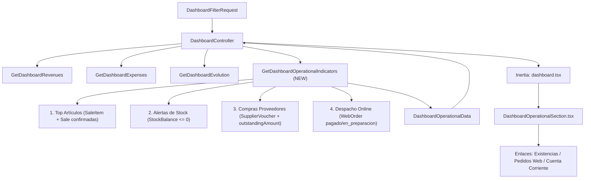

# EPIC-21 — Visualizar indicadores operativos complementarios

Implementa el cuarto y último bloque del Tablero Gerencial (`DSH-04`), brindando al Gerente visibilidad directa sobre indicadores y alertas operativas clave desde una única pantalla: los artículos más vendidos del período, alertas de artículos sin stock o en conflicto (EPIC-06), ranking de compras por proveedor con saldo de cuenta corriente, y alertas de despacho online de pedidos web pendientes de entrega (EPIC-17).

---

## Criterios de Aceptación (de `product-backlog.md`)

1. **Datos:**
   - **Top artículos más vendidos** en el período (por cantidad y por importe facturado sobre ventas confirmadas).
   - **Artículos sin stock o en conflicto de stock** (artículos activos con existencia `<= 0` o con conflicto de stock por ventas sin existencia `EPIC-06`, indicando depósito y existencia actual).
   - **Ranking de compras por proveedor** en el período (monto total de comprobantes confirmados y saldo pendiente de cuenta corriente).
   - **Alertas operativas de despacho online:** cantidad de pedidos web en estado `pagado` o `en_preparacion` pendientes de entrega en depósito (`EPIC-17`).
2. **Validaciones:**
   - Todos los rankings respetan los filtros activos del tablero cuando corresponden (rango de fechas, sucursal y canal).
3. **Comportamiento:**
   - Cada tarjeta operativa muestra el top 5/10 y ofrece un enlace directo a la pantalla operativa correspondiente (*Existencias de stock*, *Pedidos web por preparar*, *Cuenta corriente de proveedores*).
4. **Verificación:**
   - Se vende un artículo convirtiéndolo en el número 1 del período y queda un pedido online pagado pendiente de entrega; ambos aparecen en sus respectivos paneles del tablero gerencial.

---

## Investigación del Código Existente

| Artefacto | Ubicación | Propósito y Relevancia |
|---|---|---|
| DTOs de Dashboard | `app/Data/Reporting/` | `DashboardData` ya tiene `public ?DashboardOperationalData $operational = null`. `DashboardOperationalData`, `DashboardTopArticleData`, `DashboardStockAlertData` y `DashboardSupplierRankingData` ya están definidos y tipados. |
| Controlador | `app/Http/Controllers/Reporting/DashboardController.php` | Orquesta la carga de datos del tablero. Recibe `DashboardFilterRequest`, invoca las Actions de Reporting y renderiza `dashboard.tsx`. |
| Filtros | `app/Http/Requests/Reporting/DashboardFilterRequest.php` | Valida y normaliza `date_from`, `date_to`, `branch_id` y `channel`. Por defecto toma el mes en curso. |
| Actions de Reporting previas | `app/Actions/Reporting/` | `GetDashboardRevenues`, `GetDashboardExpenses` y `GetDashboardEvolution`. Usan el trait `ConvertsMoneyToCents`, consultas eficientes y lazy loading/agrupaciones en base de datos. |
| Modelo `Sale` y `SaleItem` | `app/Models/Sales/` | Ventas confirmadas (`status = SaleStatus::Confirmed`, `confirmed_at`). `SaleItem` contiene `quantity`, `line_total`, `article_id`. |
| Modelo `StockBalance` | `app/Models/Inventory/StockBalance.php` | Existencias actuales por depósito y artículo (`decimal:3`). Existencia negativa (`quantity < 0`) representa conflicto de stock originado por ventas sin stock (`EPIC-06`). |
| Modelo `SupplierVoucher` | `app/Models/Purchasing/SupplierVoucher.php` | Comprobantes de compras (`Invoice`, `DebitNote`, `CreditNote`). Métodos `withBalanceAggregates()` y `outstandingAmount()` para derivar el saldo pendiente de cuenta corriente sin duplicar lógica. |
| Modelo `WebOrder` | `app/Models/Ecommerce/WebOrder.php` | Pedidos de tienda online. Estados `WebOrderStatus::Paid` y `WebOrderStatus::InPreparation` representan pedidos pendientes de entrega física en depósito (`EPIC-17`). |
| Componentes React | `resources/js/pages/dashboard/` | `dashboard.tsx` y `partials/dashboard-operational-section.tsx`. Actualmente renderiza `DashboardSectionPlaceholder`. |
| Wayfinder & Rutas | `resources/js/routes/` | Rutas operativas existentes: `@/routes/inventory/stocks`, `@/routes/ecommerce/orders`, `@/routes/purchasing/account-statement`. |
| Autorización | `app/Enums/Security/Permission.php` y `resources/js/hooks/use-can.ts` | Gates `manage-stock`, `manage-web-orders`, `manage-purchases` para condicionar visibilidad de accesos directos según permisos. |

---

## User Review Required

> [!NOTE]
> Los DTOs `DashboardOperationalData`, `DashboardTopArticleData`, `DashboardStockAlertData` y `DashboardSupplierRankingData` ya fueron creados previamente en el Sprint 5 (D2 Base del Tablero) y están cubiertos por `tests/Feature/Reporting/DashboardDataTest.php`. No requieren cambios estructurales en su firma, preservando compatibilidad total.

> [!IMPORTANT]
> **Criterio de aplicación de filtros "cuando corresponden":**
> 1. **Top artículos más vendidos:** Aplican fechas (`sales.confirmed_at`), sucursal (`pointOfSale.warehouse.branch_id`) y canal (`sales.channel`).
> 2. **Alertas de stock:** No aplican fechas (el stock refleja la existencia física actual en tiempo real). Aplican sucursal (`warehouse.branch_id`) y canal (`warehouse.is_online_channel`).
> 3. **Ranking de compras por proveedor:** Aplican fechas (`issue_date`). Si se selecciona sucursal, filtra comprobantes asociados al depósito de esa sucursal si está especificado (`whereHas('warehouse', ...)`). El canal no afecta directamente las compras a proveedores generales a menos que se restrinja por el depósito online.
> 4. **Alertas de despacho online:** Aplica canal (si `channel === 'mostrador'`, la alerta online reporta 0; si `channel === 'online'` o `null`, reporta los pedidos pendientes). Aplica sucursal si el pedido es de retiro en sucursal (`pickup_branch_id = branch_id`) o si el depósito online pertenece a dicha sucursal.

---

## Proposed Changes



---

### Backend — Actions

#### [NEW] `app/Actions/Reporting/GetDashboardOperationalIndicators.php`
- Acción encargada de orquestar y computar los 4 indicadores operativos.
- Utiliza `ConvertsMoneyToCents` para cálculos monetarios y conversiones sin pérdida de precisión.
- Métodos internos:
  1. `topArticles(CarbonImmutable $from, CarbonImmutable $to, ?int $branchId, ?SaleChannel $channel, int $limit = 10): array`:
     - Consulta `SaleItem` unidos a `sales` y `articles`.
     - `sales.status = SaleStatus::Confirmed` y `sales.confirmed_at BETWEEN $from AND $to`.
     - Filtros condicionales por `sales.channel` y `sale.pointOfSale.warehouse.branch_id`.
     - Agrupa por `articles.id` y `articles.description`.
     - Calcula `SUM(sale_items.quantity)` y `SUM(sale_items.line_total)`.
     - Ordena por cantidad vendida descendente (`SUM(sale_items.quantity) DESC`, desempate por importe facturado).
     - Mapea a instancias de `DashboardTopArticleData(article_id, description, quantity, total_invoiced)`.
  2. `stockAlerts(?int $branchId, ?SaleChannel $channel, int $limit = 10): array`:
     - Consulta `StockBalance` unido con `articles` y `warehouses`.
     - Filtra artículos activos (`articles.status = ArticleStatus::Active`) y depósitos activos (`warehouses.is_active = true`).
     - Condición de alerta: `stock_balances.quantity <= 0`.
     - Filtros condicionales: `warehouses.branch_id = $branchId`, y según `channel` (`is_online_channel = true` si online, `false` si mostrador).
     - `has_stock_conflict = (float) $row->quantity < 0` (existencia negativa por venta sin stock según EPIC-06).
     - Ordena con prioridad de conflicto: `stock_balances.quantity ASC` (los saldos más negativos primero, luego ceros) y `articles.description ASC`.
     - Mapea a `DashboardStockAlertData(article_id, article_description, warehouse_id, warehouse_name, quantity, has_stock_conflict)`.
  3. `supplierRanking(CarbonImmutable $from, CarbonImmutable $to, ?int $branchId, ?SaleChannel $channel, int $limit = 10): array`:
     - Consulta `SupplierVoucher` de tipos `Invoice`, `DebitNote` y `CreditNote` no anulados (`status != SupplierVoucherStatus::Cancelled`).
     - Rango de fechas `issue_date BETWEEN $from AND $to`.
     - Filtro condicional por depósito/sucursal si aplica.
     - Agrupa por proveedor calculando compras netas devengadas del período: Invoices + DebitNotes − CreditNotes.
     - Selecciona los proveedores con mayor volumen de compra en el período.
     - Para dichos proveedores, deriva el `outstanding_balance` actual utilizando `SupplierVoucher::withBalanceAggregates()` y sumando `outstandingAmount()` (mismo cálculo garantizado por `GetSupplierAccountStatement`).
     - Mapea a `DashboardSupplierRankingData(supplier_id, name, purchases_total, outstanding_balance)`.
  4. `pendingWebOrdersCount(?int $branchId, ?SaleChannel $channel): int`:
     - Si `$channel === SaleChannel::Counter->value`, retorna `0` (el mostrador no gestiona pedidos web).
     - Consulta `WebOrder::query()->whereIn('status', [WebOrderStatus::Paid, WebOrderStatus::InPreparation])`.
     - Aplica filtro de sucursal si corresponde (`pickup_branch_id = $branchId` o depósito online asociado a la sucursal).
     - Retorna el conteo entero.

---

### Backend — Controller

#### [MODIFY] `app/Http/Controllers/Reporting/DashboardController.php`
- Inyectar `GetDashboardOperationalIndicators $getDashboardOperationalIndicators` en el método `index()`.
- Invocar:
  ```php
  $operational = $getDashboardOperationalIndicators->handle($filters);
  ```
- Pasar `$operational` en la construcción de `DashboardData`:
  ```php
  $dashboard = new DashboardData(
      filters: new DashboardFiltersData(...$filters),
      branches: $branches->map(fn (Branch $branch): DashboardBranchOptionData => DashboardBranchOptionData::fromModel($branch))->all(),
      revenues: $revenues,
      expenses: $expenses,
      evolution: $getDashboardEvolution->handle($filters, $revenues, $expenses),
      operational: $operational,
  );
  ```

---

### Frontend — Componentes React

#### [MODIFY] `resources/js/pages/dashboard/partials/dashboard-operational-section.tsx`
- Reemplazar el `DashboardSectionPlaceholder` por la sección completa de indicadores operativos.
- Diseño responsivo y consistente con `dashboard-revenues-section.tsx` y `dashboard-expenses-section.tsx`:
  1. **Cabecera de sección:** Título "Indicadores operativos" y descripción.
  2. **Banner / Tarjeta destacada de Alerta de Despacho Online:**
     - Conteo prominente de `pending_web_orders_count`.
     - Alerta visual destacada cuando `pending_web_orders_count > 0`.
     - Botón de enlace directo a *Pedidos web por preparar* (`ecommerce.orders.index`).
     - Protegido con `can('manage-web-orders')`.
  3. **Grid de 3 Tarjetas Operativas (Top 5/10):**
     - **Tarjeta 1: Top artículos más vendidos:**
       - Tabla con: Posición (#), Artículo (descripción), Cantidad vendida y Total facturado.
       - Mensaje vacío si no hubo ventas confirmadas en el período.
     - **Tarjeta 2: Alertas de stock:**
       - Tabla con: Artículo, Depósito, Existencia actual y Badge de estado (`Conflicto` en rojo/destructivo si `has_stock_conflict`, `Sin stock` en secundario si `quantity == 0`).
       - Botón de enlace directo a *Existencias de stock* (`inventory.stocks.index`).
       - Protegido con `can('manage-stock')`.
       - Mensaje amigable si no hay alertas de stock.
     - **Tarjeta 3: Compras por proveedor:**
       - Tabla con: Proveedor, Compras del período y Saldo pendiente CC.
       - Botón de enlace directo a *Cuenta corriente de proveedores* (`purchasing.account-statement.index`).
       - Protegido con `can('manage-purchases')`.
       - Mensaje amigable si no hay compras a proveedores en el período.

---

### Automated Tests

#### [NEW] `tests/Feature/Reporting/GetDashboardOperationalIndicatorsTest.php`
- Test unitario y de integración de la Action:
  1. **Top artículos más vendidos:**
     - Ordena correctamente por cantidad e importe sobre ventas confirmadas.
     - Excluye ventas abiertas o descartadas.
     - Respeta filtros de fechas, canal y sucursal.
  2. **Alertas de stock:**
     - Detecta existencias `<= 0`.
     - Marca `has_stock_conflict = true` cuando `quantity < 0`.
     - Excluye artículos y depósitos inactivos.
     - Respeta filtros de sucursal y canal.
  3. **Ranking de compras por proveedor:**
     - Suma comprobantes confirmados (facturas, notas de débito, restando notas de crédito).
     - Excluye comprobantes anulados.
     - Calcula correctamente el saldo pendiente de cuenta corriente con `outstandingAmount()`.
  4. **Despacho online:**
     - Cuenta pedidos en estado `pagado` y `en_preparacion`.
     - Ignora pedidos `entregado` o `pendiente` de pago.
     - Retorna 0 cuando se filtra canal `mostrador`.

#### [NEW] `tests/Feature/Reporting/DashboardOperationalIntegrationTest.php`
- Prueba integral del escenario del Criterio de Verificación de `product-backlog.md`:
  - Se vende un artículo convirtiéndolo en el número 1 del período.
  - Queda un pedido online pagado pendiente de entrega.
  - Al solicitar `GET /dashboard`, se verifica vía Inertia assertions que:
    - El artículo vendido figura como primer puesto en `operational.top_articles`.
    - El pedido web pagado incrementa `operational.pending_web_orders_count`.
    - La vista contiene los enlaces directos y la respuesta es exitosa (código 200).

---

## Verification Plan

### Automated Tests
```bash
# Correr tests unitarios de la action de indicadores operativos
php artisan test --compact tests/Feature/Reporting/GetDashboardOperationalIndicatorsTest.php

# Correr test de integración del dashboard con indicadores operativos
php artisan test --compact tests/Feature/Reporting/DashboardOperationalIntegrationTest.php

# Correr suite completa de reporting
php artisan test --compact --filter=Dashboard

# Verificaciones estáticas y de calidad requeridas por CI
vendor/bin/pint --dirty --format agent
composer run types:check
npm run types:check
npm run lint:check
npm run format:check
```

### Manual Verification
1. Iniciar sesión como usuario con rol `Gerente` (o permisos de administración y visualización del tablero).
2. Navegar a `/dashboard`.
3. Comprobar que la sección "Indicadores operativos" ya no muestra el placeholder de EPIC-21, sino:
   - Tarjeta de pedidos web pendientes de entrega con su enlace a `/ecommerce/orders`.
   - Tarjeta de top artículos más vendidos mostrando cantidades y totales facturados.
   - Tarjeta de alertas de stock con badges de "Sin stock" / "Conflicto" y su enlace a `/inventory/stocks`.
   - Tarjeta de compras por proveedor con compras del período, saldo pendiente y enlace a `/purchasing/account-statement`.
4. Cambiar filtros de fecha, sucursal y canal y verificar que las tarjetas actualizan sus datos en tiempo real de forma consistente con el resto del tablero.
