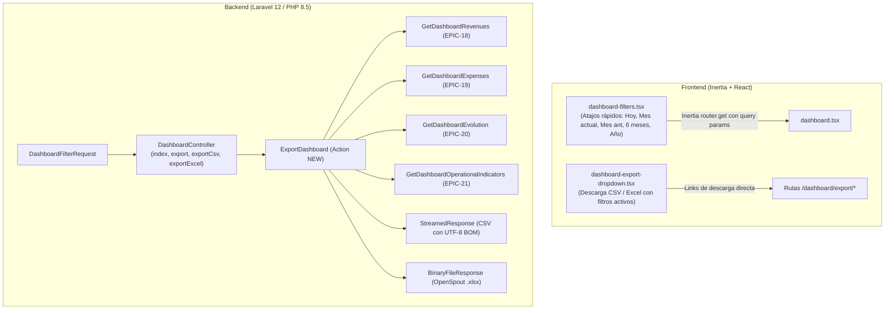

# EPIC-22 — Filtrar y exportar el tablero gerencial

Completa el módulo del Tablero Gerencial (`DSH-05`), permitiendo al Gerente filtrar de forma consistente todo el tablero por rango de fechas (con atajos rápidos de selección), sucursal y canal con sincronización bidireccional en la URL mediante Inertia, y exportar un informe ejecutivo consolidado a formatos CSV y Excel (.xlsx) que refleja con exactitud las cifras calculadas en los cuatro bloques del tablero (`EPIC-18`, `EPIC-19`, `EPIC-20` y `EPIC-21`).

---

## Criterios de Aceptación (de `product-backlog.md`)

1. **Datos:**
   - Filtros globales del tablero:
     - Rango de fechas `date_from` y `date_to` con atajos rápidos: *Hoy*, *Este mes*, *Mes anterior*, *Últimos 6 meses*, *Este año*.
     - `branch_id` opcional.
     - `channel` opcional: `todos`, `mostrador`, `online`.
   - Archivo exportable en formato CSV y Excel (`.xlsx`).
2. **Validaciones:**
   - `date_to` no puede ser anterior a `date_from`.
   - Si se filtra por canal `online`, los egresos generales de proveedores se aclaran como globales de la empresa o se filtran por el depósito asignado a la sucursal seleccionada.
3. **Comportamiento:**
   - La barra superior del Tablero Gerencial mantiene sincronizados los filtros en la URL (query params con Inertia) y actualiza todos los bloques (`EPIC-18`, `EPIC-19`, `EPIC-20` y `EPIC-21`) de manera consistente.
   - El botón de exportación descarga un archivo (Excel/CSV siguiendo el patrón de `HU-028`/`HU-055`) con el resumen de ingresos, egresos, evolución y rankings correspondientes exactamente a los filtros aplicados.
4. **Verificación:**
   - Se filtra el tablero por una sucursal y el canal `mostrador`, se comprueba que los KPIs reflejan solo esa sucursal y canal, y al exportar el archivo descargado contiene esas mismas cifras.

---

## Investigación del Código Existente

| Artefacto | Ubicación | Propósito y Relevancia |
|---|---|---|
| Controlador del Dashboard | `app/Http/Controllers/Reporting/DashboardController.php` | Orquesta la carga de los 4 bloques del tablero. Se ampliará con los métodos `exportCsv`, `exportExcel` y `export` despachando a la nueva Action. |
| Form Request de Filtros | `app/Http/Requests/Reporting/DashboardFilterRequest.php` | Ya normaliza y valida `date_from`, `date_to`, `branch_id` y `channel`. Se añade validación para el parámetro opcional `format` (`csv`, `excel`, `xlsx`). |
| Acciones de Reporting existentes | `app/Actions/Reporting/` | `GetDashboardRevenues`, `GetDashboardExpenses`, `GetDashboardEvolution`, `GetDashboardOperationalIndicators`. La exportación reutilizará directamente estas 4 acciones para garantizar consistencia absoluta entre pantalla y archivo sin duplicar lógica de cálculo. |
| Patrón de exportación CSV/Excel | `app/Http/Controllers/Purchasing/PaymentOrderController.php` (HU-055) y `SupplierAccountStatementController.php` (HU-028) | Patrón canónico del proyecto: CSV con `response()->streamDownload()`, BOM UTF-8 y delimitador `;`. Excel con `OpenSpout\Writer\XLSX\Writer` y `response()->download()->deleteFileAfterSend(true)`. |
| Barra de Filtros actual | `resources/js/pages/dashboard/partials/dashboard-filters.tsx` | Contiene inputs de fecha, selectores de sucursal y canal, y botones Filtrar / Reset. Se incorporan los botones de atajos rápidos con navegación inmediata vía Inertia. |
| Sección de Egresos | `resources/js/pages/dashboard/partials/dashboard-expenses-section.tsx` | Presenta los egresos devengados y desembolsados. Se refuerza la aclaración contextual cuando el canal activo es `online`. |
| Vista principal del Dashboard | `resources/js/pages/dashboard.tsx` | Contenedor de la pantalla gerencial. Se incorpora el botón/dropdown de exportación en el encabezado superior. |
| Rutas y Permisos | `routes/web.php` y `tests/Feature/Security/ModuleAuthorizationTest.php` | Rutas protegidas bajo el middleware `can:view-dashboard`. Se incorporan las rutas de exportación bajo el prefijo `dashboard`. |

---

## Proposed Changes



---

### Backend — Actions

#### [NEW] `app/Actions/Reporting/ExportDashboard.php`
- Acción encargada de orquestar la obtención de datos y formatear el documento exportable.
- Inyecta por constructor:
  - `GetDashboardRevenues $getRevenues`
  - `GetDashboardExpenses $getExpenses`
  - `GetDashboardEvolution $getEvolution`
  - `GetDashboardOperationalIndicators $getOperational`
- Métodos públicos:
  - `toCsv(array $filters): StreamedResponse`: genera archivo `.csv` con BOM UTF-8, delimitador `;` y encabezados legibles para Excel.
  - `toExcel(array $filters): BinaryFileResponse`: genera archivo `.xlsx` mediante `OpenSpout\Writer\XLSX\Writer` en archivo temporal y descarga con `deleteFileAfterSend(true)`.
- Estructura unificada de datos exportados:
  1. **Encabezado y Metadatos:**
     - Título: `TABLERO GERENCIAL - SUPERMERCADOS LA LINDA`
     - Período: `date_from` al `date_to`
     - Sucursal: Nombre de la sucursal o "Todas las sucursales"
     - Canal: "Mostrador", "Online" o "Todos los canales"
     - Fecha y hora de generación
     - Aclaración de alcance para compras/egresos (con mención explícita si el canal es `online`).
  2. **1. Resumen de Ingresos (EPIC-18):**
     - Total Facturado, Ingresos Netos, Ventas Confirmadas (cantidad).
     - Tabla de desglose por canal (Canal, Ventas, Monto facturado).
     - Tabla de desglose por medio de pago (Medio de pago, Operaciones, Monto cobrado).
  3. **2. Resumen de Egresos (EPIC-19):**
     - Comprobantes recibidos (devengado), Pagado a proveedores, Egresos operativos de caja, Desembolso total efectivo.
     - Tabla de desglose de pagos a proveedores por medio de pago (Medio de pago, Pagos, Monto pagado).
  4. **3. Resultado y Evolución Temporal (EPIC-20):**
     - Resultado neto del período, Margen neto (%), Variación respecto al período anterior (%).
     - Tabla de serie temporal de evolución (Período, Ingresos netos, Egresos devengados, Resultado neto).
  5. **4. Indicadores Operativos (EPIC-21):**
     - Pedidos web pendientes de preparación / entrega (cantidad).
     - Ranking de artículos más vendidos (Posición, Artículo, Cantidad vendida, Total facturado).
     - Alertas de stock crítico y conflictos (Artículo, Depósito, Existencia actual, Conflicto).
     - Ranking de compras por proveedor (Posición, Proveedor, CUIT, Comprobantes, Total compras, Saldo en cta. cte.).

---

### Backend — Form Request

#### [MODIFY] `app/Http/Requests/Reporting/DashboardFilterRequest.php`
- Se incorpora la validación para el parámetro opcional `format`:
  ```php
  'format' => ['nullable', 'string', 'in:csv,excel,xlsx'],
  ```
- Permite reutilizar el request de manera unificada tanto en la vista del dashboard como en los endpoints de exportación.

---

### Backend — Controller

#### [MODIFY] `app/Http/Controllers/Reporting/DashboardController.php`
- Incorpora los métodos de exportación:
  - `export(DashboardFilterRequest $request, ExportDashboard $exportDashboard): BinaryFileResponse|StreamedResponse`
    - Despacha a CSV si `format === 'csv'`, de lo contrario a Excel.
  - `exportCsv(DashboardFilterRequest $request, ExportDashboard $exportDashboard): StreamedResponse`
    - Invoca `$exportDashboard->toCsv($request->filters())`.
  - `exportExcel(DashboardFilterRequest $request, ExportDashboard $exportDashboard): BinaryFileResponse`
    - Invoca `$exportDashboard->toExcel($request->filters())`.

---

### Rutas

#### [MODIFY] `routes/web.php`
- Se definen las rutas de exportación dentro del grupo `internal.staff` y protegidas con `can:view-dashboard`:
  ```php
  Route::prefix('dashboard/export')->name('dashboard.export.')->middleware('can:view-dashboard')->group(function () {
      Route::get('/', [DashboardController::class, 'export'])->name('index');
      Route::get('csv', [DashboardController::class, 'exportCsv'])->name('csv');
      Route::get('excel', [DashboardController::class, 'exportExcel'])->name('excel');
  });
  ```
- Tras modificar rutas, se ejecuta `php artisan wayfinder:generate` para generar las funciones TypeScript tipadas en `@/routes/dashboard/export`.

---

### Frontend — Componentes React

#### [NEW] `resources/js/pages/dashboard/partials/dashboard-export-dropdown.tsx`
- Componente de dropdown reutilizable siguiendo el patrón exacto de `HU-028` y `HU-055`:
  - Botón "Exportar" con icono `Download`.
  - Opciones "Exportar a CSV" (`FileText`) y "Exportar a Excel (.xlsx)" (`FileSpreadsheet`).
  - Utiliza `csv.url({ query })` y `excel.url({ query })` sincronizados con los filtros activos.

#### [MODIFY] `resources/js/pages/dashboard/partials/dashboard-filters.tsx`
- Se agrega la barra de **Atajos rápidos**:
  - Botones compactos: *Hoy*, *Este mes*, *Mes anterior*, *Últimos 6 meses*, *Este año*.
  - Cálculo robusto de fechas con hora local para evitar desfasajes de zona horaria:
    - *Hoy*: fecha actual a fecha actual.
    - *Este mes*: primer día del mes corriente hasta la fecha actual.
    - *Mes anterior*: primer día al último día del mes calendario anterior.
    - *Últimos 6 meses*: fecha hace 6 meses hasta la fecha actual.
    - *Este año*: 1 de enero del año corriente hasta la fecha actual.
  - Al hacer clic en un atajo, actualiza los campos de fecha y ejecuta inmediatamente la consulta vía `router.get()` de Inertia con `preserveState: true` y `preserveScroll: true`.

#### [MODIFY] `resources/js/pages/dashboard.tsx`
- Se integra `<DashboardExportDropdown filters={filters} />` en el encabezado de la página junto a `Heading`.
- Mantiene la reactividad completa cuando cambian los filtros.

#### [MODIFY] `resources/js/pages/dashboard/partials/dashboard-expenses-section.tsx`
- Se agrega aviso explícito cuando `filters.channel === 'online'`:
  - *"Filtro por canal online: Las compras y pagos a proveedores se consolidan como globales de la empresa. La sucursal seleccionada filtra los egresos operativos de caja."*

---

## Verificación de la Definition of Done

| Criterio | Cómo se verifica |
|---|---|
| Filtros globales: fechas, sucursal, canal y atajos rápidos | Se prueban los atajos *Hoy*, *Este mes*, *Mes anterior*, *Últimos 6 meses* y *Este año*; la URL se actualiza con los query params y todos los bloques del tablero se recalculan. |
| Validación `date_to` no menor a `date_from` | Test en Pest verifica que fechas invertidas devuelven error de validación en sesión (`assertSessionHasErrors`). |
| Aclaración de canal online en egresos | Verificación en UI y en el documento exportado de la aclaración cuando `channel = online`. |
| Exportación CSV descargable | Petición a `/dashboard/export/csv` devuelve `text/csv`, con status 200, BOM UTF-8 y contenido de los 4 bloques. |
| Exportación Excel (.xlsx) descargable | Petición a `/dashboard/export/excel` devuelve `application/vnd.openxmlformats-officedocument.spreadsheetml.sheet`, status 200 y archivo binario válido. |
| Cifras idénticas entre pantalla y archivo exportado | Test integral crea ventas, egresos y comprobantes para una sucursal y canal, comprueba las props de Inertia y verifica que el CSV exportado contiene exactamente los mismos totales. |
| Autorización por roles | Tests en `ModuleAuthorizationTest` y específicos verifican que roles sin `view-dashboard` (ej. cajero, depósito) reciben 403 Forbidden. |

---

## Verification Plan

### Automated Tests
1. **Tests de Exportación:**
   - Crear `tests/Feature/Reporting/DashboardExportTest.php` con cobertura para:
     - Descarga exitosa de CSV y Excel por Gerente / Administrador.
     - Bloqueo con 403 Forbidden para Cajero / Depósito / Cliente.
     - Despacho de `/dashboard/export?format=csv` y `/dashboard/export?format=xlsx`.
     - Coincidencia exacta de cifras exportadas (ingresos, egresos, evolución, top artículos, ranking compras, alertas stock) con filtros de sucursal y canal.
     - Inclusión de metadatos y notas aclaratorias en caso de canal online.
2. **Tests de Filtros y Atajos:**
   - Actualizar `tests/Feature/DashboardTest.php` para validar el parámetro `format` y los rangos de fechas de atajos rápidos.
3. **Ejecución:**
   ```bash
   php artisan test --compact tests/Feature/DashboardTest.php tests/Feature/Reporting/DashboardExportTest.php
   ```

### Manual Verification
1. Iniciar sesión como Gerente (`gerente@lalinda.com`).
2. Abrir `/dashboard`.
3. Probar los atajos rápidos (*Hoy*, *Este mes*, *Mes anterior*, *Últimos 6 meses*, *Este año*): verificar que la fecha de los inputs cambia y la URL se actualiza inmediatamente sin recargar la página entera.
4. Seleccionar una sucursal específica y el canal "Mostrador", presionar "Filtrar".
5. Abrir el menú "Exportar" y descargar en CSV y en Excel (.xlsx).
6. Abrir los archivos descargados y verificar que las cifras de totales facturados, egresos devengados y rankings coinciden exactamente con los valores visibles en pantalla.
7. Cambiar el canal a "Online" y verificar la aclaración de alcance en pantalla y en el archivo exportado.

### CI checks
```bash
vendor/bin/pint --dirty --format agent
composer run types:check
npm run types:generate
npm run types:check
npm run lint:check
npm run format:check
php artisan test --compact
```

---

## Open Questions

*No se registran preguntas abiertas. Los criterios de aceptación, el diseño de datos y el patrón de exportación (HU-028/HU-055) están completamente definidos en el backlog y en el código base.*
